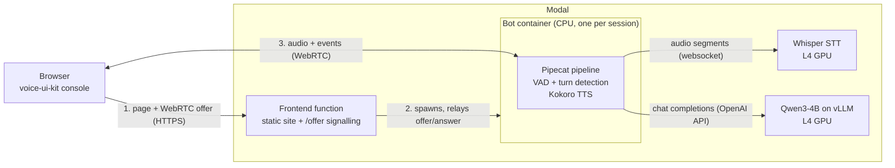

# Multilingual Voice AI

A real-time voice assistant you talk to in the browser, built on
[Pipecat](https://github.com/pipecat-ai/pipecat) and running entirely on
[Modal](https://modal.com) with open models: Whisper for speech-to-text, Qwen3
on vLLM for the language model, and Kokoro for text-to-speech.

The goal is a **multilingual** voice assistant, including for people who mix
languages in the same conversation. It currently runs as an **English
baseline**: the open models for other languages weren't good enough yet (see
[Roadmap](#roadmap)), so the pipeline was made to work, measured, and tuned
in English first.

Everything learned along the way (what broke, why, and what it cost in
seconds) is in [FINDINGS.md](FINDINGS.md). For a full walkthrough of the
code (every file, how they connect, and what each library does) see
[docs/HOW_IT_WORKS.md](docs/HOW_IT_WORKS.md).

## How it works



1. The browser loads the console page from the frontend function and sends a
   WebRTC offer to `/offer`.
2. The frontend starts a **bot container** for the session and passes the
   offer to it through a Modal Dict; the bot's answer comes back the same
   way. Later renegotiation offers for the same connection are routed to the
   same bot through a Modal Queue.
3. Audio then flows directly between the browser and the bot over WebRTC.

Inside the bot, one user turn goes through this pipeline:

| Step | What happens | Where |
|---|---|---|
| Voice activity detection | Silero VAD splits speech into segments at 0.3 s pauses | Bot container |
| Speech-to-text | Each segment is sent to Whisper over a websocket and transcribed | STT container (GPU) |
| Turn detection | Pipecat's smart-turn model decides whether the user has finished, or waits | Bot container |
| Language model | The turn goes to Qwen3-4B; the reply streams back token by token | LLM container (GPU) |
| Text-to-speech | Each sentence of the reply is spoken by Kokoro as it arrives | Bot container (CPU) |
| Playback | Audio goes back to the browser over WebRTC; the user can interrupt at any time | Browser |

## Architecture choices

| Part | Choice | Why |
|---|---|---|
| Orchestration | **Pipecat 1.12** with the SmallWebRTC transport | Handles the real-time pipeline (VAD, turn-taking, interruptions, streaming), so the project only writes the model glue. SmallWebRTC connects the browser straight to the bot, with no media server to run. |
| Hosting | **Modal**, for everything | GPUs on demand, scale to zero when idle, deployed from Python. The cost of scaling to zero is cold starts (see [Performance](#performance)). |
| Speech-to-text | **faster-whisper `large-v3-turbo`**, fp16, on an L4 | Strong accuracy at low latency (~0.25 s per segment once warm), and it covers many languages, for the multilingual work. Runs in its own GPU container, reached through a Modal tunnel. |
| Language model | **Qwen3-4B-Instruct** on **vLLM 0.21**, on an L4 | Small enough for one L4 and fast to first token (~0.15 s). vLLM gives an OpenAI-compatible API that Pipecat already speaks. The weights are baked into the image so no container downloads them. |
| Text-to-speech | **Kokoro-82M** (`af_heart` voice), in the bot container on 4 vCPUs | ~0.5 s to first audio for a short sentence, with no GPU, no network hop, and no extra cold start. Replaced Chatterbox (below). |
| Turn-taking | **Silero VAD** + **Pipecat smart-turn v3** | VAD finds pauses; smart-turn decides whether a pause is the end of the turn, so the bot doesn't cut people off mid-thought. |
| Client | **Pipecat voice-ui-kit** console (React, Vite) | A ready-made debugging UI with a live event log, served as static files from Modal. |

Tried and replaced:
- **Chatterbox multilingual TTS** (on an L4) supports many languages, but it returns a
  whole sentence at once after ~2.5–3 s, and needs ~35 s to load plus a 23 s
  warm-up on every new container. Kokoro is ~6× faster to first audio. The
  Chatterbox server ([server/tts.py](server/tts.py)) is kept for the
  multilingual work but isn't used by the bot.

## Repository layout

```
app.py                      Bot + frontend Modal app (signalling, one bot per session)
server/
  bot/bot.py                The Pipecat pipeline: transport, VAD, STT, LLM, TTS
  bot/services/             Pipecat services for the Modal-hosted models
    modal_services.py         Tunnel manager + websocket base services
    modal_whisper_service.py  Whisper STT client
    modal_chatterbox_service.py  Chatterbox TTS client (not in use)
  stt.py                    Whisper STT server (Modal app: multilingual-stt)
  llm.py                    vLLM server (Modal app: multilingual-llm)
  tts.py                    Chatterbox TTS server (Modal app: multilingual-tts, not in use)
client/                     Browser console (React + Pipecat voice-ui-kit)
tools/
  turn_latency.py           Per-turn latency table from the bot's logs
  llm_coldstart.py          LLM cold-start and generation-speed benchmark
FINDINGS.md                 Measurements and lessons learned
```

## Setup and deployment

### Prerequisites
- A [Modal](https://modal.com) account, with the CLI authenticated
  (`modal setup`).
- [uv](https://docs.astral.sh/uv/) and Python 3.12.
- Node.js and npm, to build the client.

### 1. Install

```bash
git clone https://github.com/GrentinaK/multilingual-voice-ai.git
cd multilingual-voice-ai
uv sync
```

### 2. Deploy the model servers

```bash
uv run modal deploy server/llm.py   # Qwen3-4B on vLLM
uv run modal deploy server/stt.py   # Whisper
```

The first build of each image takes several minutes: the LLM image includes
the model weights (~7.6 GB) and the STT image includes the CUDA libraries.

Then point the bot at **your** LLM endpoint: copy the URL that
`modal deploy server/llm.py` prints and set `LLM_BASE_URL` in
[server/bot/bot.py](server/bot/bot.py) to it, with `/v1` appended. The STT
server is found by its Modal app name, so it needs no URL.

### 3. Build the client

`client/dist` isn't in git, and the bot app serves it, so build it first:

```bash
cd client
npm ci
npm run build
cd ..
```

### 4. Deploy the bot and frontend

```bash
uv run modal deploy app.py
```

Open the `serve_frontend` URL it prints, click **Connect**, and wait for
**Agent: connected** before speaking. After a period of inactivity, the
first connect is a cold start and takes a few minutes (see below).

### Developing the client locally

```bash
cd client
cp env.example .env   # set VITE_API_URL to the serve_frontend URL
npm run dev
```

The dev server proxies `/offer` to the deployed bot.

## Configuration

| Setting | Where | Current value |
|---|---|---|
| TTS voice | `TTS_VOICE` in [server/bot/bot.py](server/bot/bot.py) | `af_heart` |
| VAD pause that ends a segment | `stop_secs` in [server/bot/bot.py](server/bot/bot.py) | 0.3 s |
| Speech-to-text language | `FORCED_LANGUAGE` in [server/stt.py](server/stt.py) | `"en"` (set to `None` to detect between the languages in `SUPPORTED_LANGUAGES`) |
| System prompt | `messages` in [server/bot/bot.py](server/bot/bot.py) | Short, spoken English replies |
| LLM model version | `MODEL_REVISION` in [server/llm.py](server/llm.py) | Pinned Hugging Face commit |
| LLM idle time before scaling to zero | `scaledown_window` in [server/llm.py](server/llm.py) | 15 min |
| Max session length | `timeout` in [app.py](app.py) and [server/stt.py](server/stt.py) | 30 min |

All Python and npm dependencies are pinned to exact versions. Upgrading
Pipecat in particular has broken things silently before (see
[FINDINGS.md](FINDINGS.md)).

## Performance

From two measured test sessions, 35 turns in total (details in
[FINDINGS.md](FINDINGS.md)):

| Measure | Test 1 median | Test 2 median |
|---|---|---|
| User stops speaking → bot starts speaking | 4.43 s | 4.55 s |
| Speech-to-text, per segment | 0.25 s | 0.37 s |
| LLM, time to first token | 0.41 s | 0.37 s |
| Text-to-speech, time to first audio | 1.07 s | 0.70 s |

Most of the per-turn delay is turn detection waiting to be sure the user has
finished: in test 2, 11 of 18 turns waited its full 3 s fallback.

### Initial setup vs. current setup

| | Initial setup | Current setup |
|---|---|---|
| Text-to-speech | Chatterbox on its own GPU (2.5–3.2 s to first audio) | Kokoro on CPU in the bot (0.7–1.1 s) |
| LLM container start → ready | 281 s | 121–138 s |
| Click Connect → ready, everything cold | ~5 min 20 s | LLM part now ~2 min; full test pending |
| Click Connect → ready, GPUs warm | ~12–17 s | ~17 s |

The LLM's cold start was cut by building the model download into the image
and switching off a GPU kernel that FlashInfer compiled at every start, with
no change in generation speed (28.6 → 28.8 tokens/s). The rest is mostly
`torch.compile` and Python imports; work continues.

## Known issues

- **Cold starts take a few minutes.** The vLLM server still compiles the
  model on every new container. Work in progress; root cause in
  [FINDINGS.md](FINDINGS.md).
- **Turn detection often waits 3 s** when the user trails off, and
  occasionally answers before they've finished.
- **The bot's audio sometimes breaks up.** Cause not yet identified.
- **Barge-in feels slow.** The bot stops within ~5 ms of detecting speech,
  but detection needs 0.2 s of confident speech, and echo cancellation on
  laptop speakers can delay it further.
- **Long sentences start late and risk being cut.** A 209-character sentence
  took Kokoro 3.07 s, just past Pipecat's 3 s limit.
- **Transcribing in short segments can change the meaning** ("not working
  smoothly" was heard in pieces and answered with "That's great to hear!").
- **The assistant doesn't know today's date or recent events**: the model's
  training data ends in 2024.
- **The LLM endpoint is unauthenticated** (`unauthenticated=True` in
  [server/llm.py](server/llm.py)). Anyone with the URL can use your GPU, so add
  authentication before sharing the URL or making the repository public.

## Roadmap

1. Finish cutting the cold start (LLM compilation, Whisper's model download,
   a warm pool of bot containers).
2. Tune turn detection, barge-in, and sentence length, and fix the choppy
   audio.
3. Build the same assistant with LiveKit Agents and compare the two.
4. Multilingual support and code-switching: an LLM and TTS that are strong
   beyond English, and rules for switching languages within a conversation.
