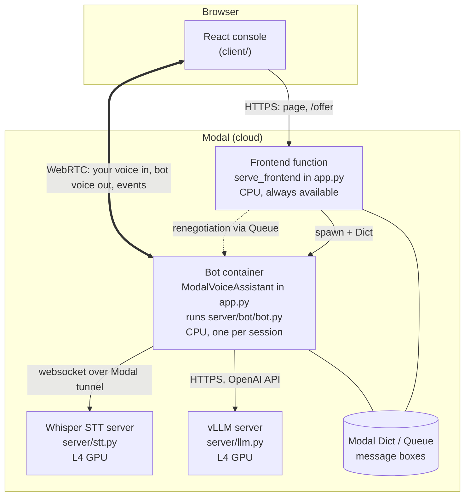

# How It Works

A complete walkthrough of this project: what every file does, how the pieces
talk to each other, which libraries do what, and how the system got to where
it is. Read it top to bottom once; after that, each section stands on its own.

Related documents:
- [README.md](../README.md): quick orientation and setup.
- [FINDINGS.md](../FINDINGS.md): measurements and lessons learned.

State described: 2026-10-09, English baseline on Pipecat 1.12.

---

## 1. The big picture

The project is a voice assistant you talk to in a browser. Five programs
cooperate to make that happen, and all but the browser run on Modal:



In one sentence: the **browser** gets its page from the **frontend
function**, asks it for a call, the frontend starts a **bot container** for
that call, and from then on the browser and bot talk directly over WebRTC
while the bot uses **Whisper** to hear and **Qwen** to think, and speaks with
**Kokoro** (which runs inside the bot itself).

### What each program is responsible for

| Program | File | Job | Hardware |
|---|---|---|---|
| Browser console | `client/` | Microphone, speaker, Connect button, live event log | Your laptop |
| Frontend function | `app.py` (`serve_frontend`) | Serves the page; brokers the start of each call | Modal CPU |
| Bot | `app.py` (`ModalVoiceAssistant`) + `server/bot/` | The conversation itself: listening, turn-taking, calling the models, speaking | Modal CPU (4 cores), one container per call |
| Speech-to-text | `server/stt.py` | Turns audio segments into text | Modal L4 GPU |
| Language model | `server/llm.py` | Writes the replies | Modal L4 GPU |
| (Unused) Chatterbox TTS | `server/tts.py` | Multilingual voice, kept for later | Modal L4 GPU |

---

## 2. Concepts you need first

Three technologies carry everything. Here's just enough of each.

### 2.1 WebRTC: how live audio gets between browser and bot

WebRTC is the browser technology for real-time audio and video (it's what
video-call apps use). Two things are worth knowing:

- **Signalling (offer and answer).** Before audio can flow, both sides must
  agree on formats and network addresses. The browser writes an **offer**
  (a text description called SDP), sends it to the server over ordinary
  HTTPS, and gets back an **answer**. In this project that exchange is the
  `POST /offer` request. After it, audio flows directly between the browser
  and the bot, not through the frontend.
- **Finding a network path (ICE and STUN).** Both sides gather possible
  addresses ("ICE candidates"). A **STUN server** (here Google's free
  `stun:stun.l.google.com:19302`) tells each side its public address. There
  is no **TURN** relay, so if a direct path can't be found (some strict
  networks), the call fails.
- **Renegotiation.** Mid-call, either side can ask to redo the offer/answer
  (for example, to add a track). The browser sends a new offer with the same
  connection ID (`pc_id`). This project has special handling for it
  (section 4.3).
- **Data channel.** Besides audio, WebRTC carries a data channel. Pipecat uses
  it for **RTVI** messages: "client ready", "bot ready", "user started
  speaking", metrics, errors. Everything in the console's event log arrives
  this way.

### 2.2 Modal: how the code runs in the cloud

Modal runs Python functions on cloud machines, defined in Python:

| Modal concept | What it means here | Where |
|---|---|---|
| `modal.App` | A deployable unit with a name. Four apps: `multilingual-voice-ai`, `multilingual-stt`, `multilingual-llm`, `multilingual-tts` | Top of each file |
| `modal.Image` | The container image (OS, Python packages, files) built at deploy time. Anything done in `.run_commands()` is baked in once | `bot_image`, `frontend_image`, `image`, `vllm_image` |
| `@app.function` | A function that runs in a container | `serve_frontend` |
| `@app.cls` | A class whose instances live in a container; `@modal.enter()` runs once when the container starts (load models here), `@modal.exit()` when it stops | `ModalVoiceAssistant`, `WhisperSTT`, `ChatterboxTTS` |
| `@app.server` | A container that runs your own web server on a port; Modal gives it a URL | `QwenLLM` |
| `@modal.asgi_app()` | Serve a FastAPI app as a web endpoint | `serve_frontend` |
| `.spawn()` | Start a function call in the background and get a handle back | Frontend starts the bot; bot starts the STT tunnel |
| `modal.Dict`, `modal.Queue` | Shared key-value store and queue that any container can read and write; used here as message boxes between containers | Signalling, STT URL hand-off |
| `modal.forward(port)` | Opens a public tunnel URL to a port inside a running container | Whisper's websocket server |
| Scale to zero | When idle, Modal stops containers; the next request starts a new one (a **cold start**) | Everything; see FINDINGS |

Two Modal behaviours that shaped the design:
- **Cold starts.** A GPU container that has scaled to zero must boot, load
  its model, and warm up before it can answer. This is the biggest source of
  waiting in the project.
- **Default timeouts.** A function call is cancelled after 300 s unless you
  set `timeout`. Long-lived calls (a conversation) need it raised.

### 2.3 Pipecat: how the conversation is run

Pipecat is a Python framework for real-time voice agents. Its model:

- **Frames** are messages: a 10–20 ms chunk of audio, a piece of text, "user
  started speaking", "interrupt", and so on.
- **Processors** receive frames, act on them, and push frames on. Frames
  mostly flow **downstream** (from microphone to speaker); some control
  frames flow **upstream** (for example, speech-detection events sent back to
  the STT).
- A **Pipeline** is a list of processors in order. A **PipelineTask** runs
  it; a **PipelineRunner** runs the task.
- A **Transport** connects the pipeline to the outside world. Here it's
  `SmallWebRTCTransport`: `transport.input()` produces audio frames from your
  microphone, `transport.output()` sends audio frames to your speaker.
- **Services** wrap models: STT services turn audio into text frames, LLM
  services turn context into text, TTS services turn text into audio.
- **Aggregators** keep the conversation history (the LLM "context"): the user
  aggregator collects what you said into one turn; the assistant aggregator
  records what the bot actually said.

The pipeline in `server/bot/bot.py` is:

```
transport.input()          your microphone audio arrives here
  → rtvi                   talks to the browser console (events, ready)
  → stt                    Whisper: audio segments → text
  → user_aggregator        speech detection, turn-taking, builds your turn
  → llm                    Qwen: your turn → reply text, streamed
  → tts                    Kokoro: reply text → audio, sentence by sentence
  → transport.output()     audio to your speaker
  → assistant_aggregator   records what the bot said into the history
```

---

## 3. Repository map

```
multilingual-voice-ai/
├── app.py                         Modal app "multilingual-voice-ai"
│                                    serve_frontend: web page + /offer signalling
│                                    ModalVoiceAssistant: the per-call bot container
├── server/
│   ├── bot/
│   │   ├── bot.py                 run_bot(): builds and runs the Pipecat pipeline
│   │   └── services/
│   │       ├── modal_services.py  ModalTunnelManager + websocket base classes
│   │       ├── modal_whisper_service.py   Pipecat STT service → Whisper server
│   │       └── modal_chatterbox_service.py Pipecat TTS service → Chatterbox (unused)
│   ├── stt.py                     Modal app "multilingual-stt": Whisper websocket server
│   ├── llm.py                     Modal app "multilingual-llm": vLLM server
│   └── tts.py                     Modal app "multilingual-tts": Chatterbox (unused)
├── client/                        React console (Vite build → client/dist)
│   ├── index.html, src/main.tsx   page entry
│   ├── src/components/app.tsx     the console, configured for this project
│   ├── vite.config.ts             build settings (served under /frontend/)
│   └── package.json               npm dependencies (pinned)
├── tools/
│   ├── turn_latency.py            per-turn latency table from bot logs
│   └── llm_coldstart.py           LLM cold-start and speed benchmark
├── pyproject.toml, uv.lock        local Python environment (Modal CLI, tools)
├── README.md, FINDINGS.md, docs/  documentation
└── .gitignore                     excludes .venv, caches, client/dist, .env
```

### Who calls whom

| From | To | How | What for |
|---|---|---|---|
| Browser | `serve_frontend` | HTTPS `GET /` | Load the console page |
| Browser | `serve_frontend` | HTTPS `POST /offer`, `PATCH /offer` | Start a call; renegotiate; ICE candidates |
| `serve_frontend` | `ModalVoiceAssistant.run_bot` | `.spawn(d)` with a Modal Dict | Start a bot for this call |
| `serve_frontend` ↔ bot | each other | Modal Dict (first offer/answer), Modal Queue (renegotiation) | Signalling |
| `app.py` bot | `server/bot/bot.py` | Python import, `run_bot(connection)` | Run the conversation |
| `bot.py` | `modal_services.ModalTunnelManager` | Python | Get Whisper's websocket URL |
| `ModalTunnelManager` | `WhisperSTT.run_tunnel_client` (stt.py) | `.spawn()` by app/class name, plus a Modal Dict | Reserve a Whisper container, receive its URL |
| `modal_whisper_service` | Whisper websocket server (stt.py) | `wss://…/ws` over `modal.forward` tunnel | Send audio, receive text |
| `bot.py` (`OpenAILLMService`, `wait_for_llm`) | vLLM (llm.py) | HTTPS to `LLM_BASE_URL` (`/v1/models`, `/v1/chat/completions`) | Readiness check; replies |
| Browser ↔ bot | each other | WebRTC audio + data channel | The conversation |

Two lookups to know about:
- The bot finds Whisper **by name** (`modal.Cls.from_name("multilingual-stt",
  "WhisperSTT")`), so no URL is configured.
- The bot finds vLLM **by URL** (`LLM_BASE_URL` in `bot.py`), which contains
  the Modal workspace name. Anyone deploying this elsewhere must change it.

---

## 4. A call from start to finish

### 4.1 Loading the page

1. Opening the `serve_frontend` URL hits `GET /`
   ([app.py:264](../app.py#L264)), which returns `/frontend/index.html`.
2. That HTML loads the built JavaScript from `/frontend/assets/…`
   ([app.py:259](../app.py#L259) mounts the directory). The build was made
   with `base: "/frontend/"` ([vite.config.ts:9](../client/vite.config.ts#L9))
   so the asset paths line up.
3. The built files come from `client/dist`, which `modal deploy app.py` copies
   into the frontend image ([app.py:233](../app.py#L233)). That's why the
   client must be built before deploying.
4. The page renders `App` ([client/src/components/app.tsx](../client/src/components/app.tsx)):
   Pipecat's `ConsoleTemplate`, told to use the SmallWebRTC transport, to send
   offers to `/offer`, to wait for ICE gathering before sending, and to use
   Google's STUN server.

### 4.2 Clicking Connect: the first offer

1. The browser asks for the microphone, creates a WebRTC peer connection with
   an audio slot (plus video slots it always adds), gathers ICE candidates,
   and `POST`s the offer to `/offer`.
2. `offer()` ([app.py:311](../app.py#L311)) sees no `pc_id`, so it's a new
   call. It opens a temporary `modal.Dict` and puts the offer and the ICE
   server list in it.
3. It **spawns** `ModalVoiceAssistant().run_bot(d)` ([app.py:344](../app.py#L344)).
   Modal starts a fresh bot container for it (one call per container,
   `max_inputs=1`), which takes ~8 s.
4. In the bot, `run_bot` ([app.py:77](../app.py#L77)) reads the offer, creates
   a Pipecat `SmallWebRTCConnection`, and calls `initialize()`, which produces
   the answer and the connection's `pc_id`.
5. The bot creates a **signalling queue** named from the `pc_id`
   ([app.py:126](../app.py#L126)) and starts listening on it for
   renegotiations (section 4.3).
6. It starts `run_bot(webrtc_connection)` from `server/bot/bot.py` as a
   background task (section 4.4), then puts the answer in the Dict.
7. Meanwhile the frontend has been polling the Dict every 0.1 s
   ([app.py:357](../app.py#L357)). It finds the answer and returns it as the
   HTTP response. The temporary Dict disappears when the `with` block ends.
8. The browser applies the answer; the WebRTC connection forms directly
   between browser and bot. The console shows "connected".

### 4.3 Renegotiation: the second offer

If the browser connects before the pipeline has started and its offer has
video slots, Pipecat asks the browser to renegotiate. The browser then sends
another `POST /offer`, this time **with** the `pc_id`.

- `offer()` sees the `pc_id` and calls `renegotiate()`
  ([app.py:276](../app.py#L276)), which puts the offer in the connection's
  queue (partition `"offer"`) and waits up to 30 s for a reply on partition
  `"answer"`.
- In the bot, `_handle_renegotiations` ([app.py:187](../app.py#L187)) takes
  the offer, calls `webrtc_connection.renegotiate()`, and puts the new answer
  back.
- Without this, the second offer used to start a **second** bot, and the call
  broke (the original bug; see FINDINGS).
- `PATCH /offer` ([app.py:270](../app.py#L270)) receives "trickled" ICE
  candidates; it just returns OK, because `waitForICEGathering: true` already
  put all candidates in the offer.

### 4.4 The bot gets ready

`run_bot` in [server/bot/bot.py](../server/bot/bot.py#L96):

1. **Reach Whisper and the LLM, in parallel, before anything else**
   ([bot.py:107](../server/bot/bot.py#L107)):
   - `stt_tunnel_manager.get_url()` reserves a Whisper container and gets its
     websocket URL (section 5.3).
   - `wait_for_llm()` ([bot.py:71](../server/bot/bot.py#L71)) polls
     `LLM_BASE_URL/models` every 2 s until vLLM answers 200. A cold vLLM
     returns 503 at first (it's booting); this is where a cold start is felt.

   This happens *before* the pipeline starts because Pipecat stops a pipeline
   whose start takes more than 20 s, and cold GPUs take longer.
2. **Build the services**: the transport, the Whisper STT service, the OpenAI
   LLM service pointed at vLLM, and Kokoro TTS (section 5).
3. **Build the conversation state**: an `LLMContext` holding the system
   prompt, a user aggregator (with Silero VAD and the smart-turn model), and
   an assistant aggregator.
4. **Assemble and run the pipeline** with interruptions and metrics on, and an
   `RTVIObserver` that reports pipeline events to the browser.
5. When the browser's console sends "client ready" over the data channel,
   `on_client_ready` replies with "bot ready"
   ([bot.py:223](../server/bot/bot.py#L223)). The console now shows the agent
   as connected.

### 4.5 One conversational turn

1. **Your voice arrives.** `transport.input()` emits audio frames (16 kHz).
   They pass through `rtvi` and the STT service unchanged (the STT also keeps
   a copy) to the user aggregator.
2. **Speech detection.** The user aggregator runs **Silero VAD** on the audio.
   After 0.2 s of confident speech it declares "user started speaking" and
   sends that event **upstream** to the STT service, and interrupts the bot if
   it was talking. After **0.3 s** of silence it declares "user stopped
   speaking".
3. **Speech-to-text, one segment at a time.** On "stopped speaking", the STT
   service (Pipecat's `SegmentedSTTService`) takes the audio since "started",
   wraps it as WAV, and calls `run_stt`
   ([modal_whisper_service.py](../server/bot/services/modal_whisper_service.py)),
   which base64-encodes it into a JSON message and sends it over the
   websocket. The Whisper server transcribes it (section 5.3) and sends back
   the text, which becomes a `TranscriptionFrame`.
4. **Turn detection.** A pause doesn't mean you've finished. The **smart-turn
   v3** model listens to the end of your speech and judges whether you sound
   done. If yes, the turn ends ~0.5 s after you stopped. If not, it waits for
   more speech, up to a **3 s** fallback. All segments in the turn are joined
   into one user message.
5. **The LLM.** The turn is added to the context and sent to vLLM as an
   OpenAI-style chat request with streaming. Tokens come back one at a time.
6. **Text-to-speech, sentence by sentence.** The TTS service collects tokens
   until a sentence ends, then has Kokoro synthesize it (in a background
   thread, so the bot keeps listening) and pushes the audio on. Sentence 2 is
   synthesized while sentence 1 plays.
7. **Playback.** Kokoro's audio arrives at 24 kHz; `transport.output()`
   splits it into 40 ms chunks and sends them over WebRTC, paced in real time.
8. **History.** The assistant aggregator records what was actually spoken, so
   if you interrupt, the history only contains what you heard.
9. **Events.** Throughout, the RTVI observer sends events to the console:
   user/bot started/stopped speaking, transcripts, metrics (the TTFB charts),
   and errors.

### 4.6 Interruptions (barge-in)

When you speak while the bot is talking, the user aggregator's VAD fires
"user started speaking", which broadcasts an **interruption**: the LLM and TTS
stop, queued audio is dropped, and the bot goes quiet within a few
milliseconds of detection. The delay you feel is mostly detection itself
(0.2 s of speech, plus echo cancellation if you're on laptop speakers); see
FINDINGS.

### 4.7 Hanging up

1. Disconnecting closes the WebRTC connection; the transport fires
   `on_client_disconnected`, which cancels the pipeline task
   ([bot.py:230](../server/bot/bot.py#L230)).
2. `run_bot`'s `finally` closes the STT tunnel manager, which releases the
   Whisper container (section 5.3).
3. Back in `app.py`, the renegotiation listener is cancelled and the
   signalling queue deleted ([app.py:175](../app.py#L175)).
4. The bot container exits. The GPU containers stay warm until their idle
   windows expire (Whisper: Modal's default, ~1 min; vLLM: 15 min), then
   scale to zero.

---

## 5. Each part in detail

### 5.1 `app.py`: frontend and bot containers

**Images.**
- `bot_image` ([app.py:24](../app.py#L24)): Debian, Python 3.12, `git` and
  `ffmpeg`, Pipecat with the extras this bot uses, and the Kokoro model files
  downloaded at build time. It also copies the `server/` folder in, which is
  how the bot code reaches the container.
- `frontend_image` ([app.py:226](../app.py#L226)): Debian, FastAPI, and the
  built client.

`with bot_image.imports():` means "only import these inside the bot
container"; the frontend container doesn't have Pipecat installed.

**`ModalVoiceAssistant`** ([app.py:66](../app.py#L66)): `timeout=30 min` (max
call length), `max_inputs=1` (one call per container), `cpu=4`,
`memory=4096` (Kokoro, VAD and smart-turn all run on CPU here).

**`serve_frontend`** ([app.py:246](../app.py#L246)): a FastAPI app with
`GET /`, the static files, `POST /offer`, and `PATCH /offer`.
`@modal.concurrent(max_inputs=100)` lets one container serve many requests.

**`signalling_queue_name`** ([app.py:16](../app.py#L16)): turns a `pc_id`
(which contains `#`, not allowed in Modal names) into a valid name of at most
64 characters by hashing it. Both containers compute the same name.

### 5.2 `server/bot/bot.py`: the conversation

| Piece | Library | Setting | Why |
|---|---|---|---|
| `SmallWebRTCTransport` | Pipecat + aiortc | 16 kHz in, 24 kHz out | Direct browser connection; Whisper wants 16 kHz, Kokoro produces 24 kHz |
| `ModalWhisperSegmentedSTTService` | our code, on Pipecat | tunnel manager | See 5.3 |
| `OpenAILLMService` | Pipecat + `openai` | `base_url=LLM_BASE_URL`, streaming | vLLM speaks the OpenAI API |
| `KokoroTTSService` | Pipecat + `kokoro-onnx` | voice `af_heart`, English | Fast CPU voice |
| `SileroVADAnalyzer` | Pipecat + Silero | `stop_secs=0.3` | Finds speech and pauses |
| `LocalSmartTurnAnalyzerV3` | Pipecat + ONNX | default (3 s fallback) | Decides if a pause ends the turn |
| `LLMUserAggregator` | Pipecat | holds VAD + turn strategy | Pipecat 1.12 reads VAD and turn settings here (not on the transport) |
| `RTVIProcessor` / `RTVIObserver` | Pipecat | — | Events to the console |
| `PipelineTask` | Pipecat | interruptions, metrics on | — |

Constants at the top ([bot.py:51](../server/bot/bot.py#L51)): sample rates,
the Whisper app/class names, the voice, the LLM URL and model name, and the
LLM wait limit (10 min).

### 5.3 Whisper: `server/stt.py`, `modal_services.py`, `modal_whisper_service.py`

This is the most involved connection, because Whisper runs in a different
container and needs a streaming connection.

**The server** (`WhisperSTT` in [stt.py](../server/stt.py)):
1. `@modal.enter() load_model` loads faster-whisper `large-v3-turbo` on the
   GPU (fp16). The model is downloaded from Hugging Face at this point, on
   every cold start (~10 s).
2. `@modal.enter() start_server` builds a FastAPI app with a websocket at
   `/ws`, runs it with uvicorn in a background thread on port 8000, and opens
   a **Modal tunnel** to that port with `modal.forward(8000)`. The tunnel's
   public `https://` URL becomes `wss://…/ws`.
3. Per websocket connection, three loops run: **receive** (JSON messages
   `{"type": "audio", "audio": <base64>}` → decoded bytes → queue),
   **inference** (bytes → 16-bit samples → float → `model.transcribe` with the
   language forced to English, or detected between `SUPPORTED_LANGUAGES` →
   text), and **send** (text back over the websocket).
4. `run_tunnel_client(d)` ([stt.py:277](../server/stt.py#L277)) is how a bot
   claims the server: it writes the websocket URL into the Dict `d`, then
   loops while `d["is_running"]` is true. While this call runs, the container
   is busy with this bot.
5. `timeout=30 min`: the call lasts as long as the conversation (it used to
   default to 300 s and cut calls at 5 minutes).

**The client side** (in the bot):
1. `ModalTunnelManager.get_url()`
   ([modal_services.py:30](../server/bot/services/modal_services.py#L30))
   creates a uniquely named Dict, sets `is_running = True`, **spawns**
   `run_tunnel_client` on the Whisper class (looked up by name), and polls the
   Dict until the URL appears (up to 120 s). If Whisper is cold, this is where
   its boot is waited for.
2. `ModalWebsocketService` connects to that URL with the `websockets` library
   and starts a receive task; it can reconnect if the connection drops.
3. `ModalWhisperSegmentedSTTService` sends each segment (`run_stt`) and turns
   each text message received into a `TranscriptionFrame`
   (`_receive_messages`).
4. `close()` sets `is_running = False` (ending `run_tunnel_client`), waits for
   the call to finish, and deletes the Dict.

By default a Modal class handles one call at a time per container, so each
concurrent conversation would hold its own Whisper GPU container.

### 5.4 The LLM: `server/llm.py`

- **Image** ([llm.py:15](../server/llm.py#L15)): NVIDIA's CUDA 12.9
  *devel* image (it includes the CUDA compiler), Python 3.12, and
  `vllm==0.21.0`, which brings PyTorch, Triton, FlashInfer, and friends. The
  model weights (Qwen3-4B-Instruct, pinned revision) are **downloaded during
  the build** and baked in.
- **Runtime settings**: `HF_HUB_OFFLINE=1` (don't contact Hugging Face;
  everything is in the image) and `VLLM_USE_FLASHINFER_SAMPLER=0` (don't
  compile FlashInfer's sampling kernel at startup).
- **`@app.server`**: Modal runs the container and routes HTTPS to port 8000.
  `startup_timeout=10 min`, `scaledown_window=15 min` (stay warm 15 min after
  the last request), `target_concurrency=1`, `unauthenticated=True` (anyone
  with the URL can use it; see Loose ends).
- **`start_vllm`** runs `vllm serve` as a subprocess with: the pinned
  revision, two served names (the full model name and `llm`), max 8,192
  tokens per conversation, one request at a time (`--max-num-seqs 1`),
  chunked prefill, and prefix caching (reuses work for the shared system
  prompt and history).
- vLLM exposes OpenAI's API: `/v1/models` (used for readiness) and
  `/v1/chat/completions` (used by the bot).

On a cold start vLLM still spends ~50 s importing and ~55–60 s compiling the
model (`torch.compile`); see FINDINGS for the full breakdown.

### 5.5 Text-to-speech: Kokoro (in use) and Chatterbox (kept)

**Kokoro** is Pipecat's built-in `KokoroTTSService`, running the 82M-parameter
Kokoro model with ONNX Runtime on the bot's CPUs. Its model files are baked
into the bot image ([app.py:42](../app.py#L42)). Inference runs in a worker
thread, so the bot keeps listening while it speaks.

**Chatterbox** ([server/tts.py](../server/tts.py) and
[modal_chatterbox_service.py](../server/bot/services/modal_chatterbox_service.py))
follows the same pattern as Whisper: a websocket server on a GPU, reached
through a tunnel. Its Pipecat service was rewritten for Pipecat 1.12's audio
contexts (each prompt's audio is routed to the reply it belongs to). It isn't
used now because it's ~6× slower to first audio, but it supports many
languages, so it's kept for the multilingual work.

### 5.6 The client: `client/`

| File | Role |
|---|---|
| `index.html` | Page shell; loads `src/main.tsx` |
| `src/main.tsx` | Mounts `App` inside the voice-ui-kit `ThemeProvider`; imports `global.css` |
| `src/components/app.tsx` | The only real component: a full-screen `ConsoleTemplate` set up for SmallWebRTC, `/offer`, ICE gathering, STUN, no camera/screen share |
| `src/global.css` | voice-ui-kit styles and two colour overrides |
| `vite.config.ts` | React plugin; `base: "/frontend/"`; in dev mode, proxies `/offer` to `VITE_API_URL` |
| `package.json` | Pinned Pipecat client packages; React 19; Vite and TypeScript for building |

The Pipecat client libraries split the work: `client-js` (the RTVI protocol
and client state), `client-react` (React hooks), `small-webrtc-transport`
(the browser side of SmallWebRTC: offers, renegotiation, ICE), and
`voice-ui-kit` (the console UI, charts and event log).

### 5.7 The tools: `tools/`

- `turn_latency.py`: reads a saved bot log and prints, per turn, the
  end-to-end delay, the time to end the turn, and the STT/LLM/TTS
  time-to-first-output, plus medians and p90.
- `llm_coldstart.py`: times how long vLLM takes to answer from cold, then
  measures time to first token and tokens per second over five prompts.
  Standard library only.

---

## 6. Dependencies

Every version is pinned; Pipecat changing underneath the project broke it
once already.

### 6.1 Bot image (`app.py`)

| Package | Version | What it does here |
|---|---|---|
| `pipecat-ai` | 1.12.0 | The framework. Extras pull in: `webrtc` (aiortc: WebRTC in Python), `openai` (OpenAI client for vLLM), `silero` (VAD model), `local-smart-turn` (turn model, ONNX), `kokoro` (kokoro-onnx + ONNX Runtime) |
| `websockets` | 17.2 | Websocket client to Whisper |
| `loguru` | 0.7.3 | Logging |
| `fastapi[standard]` | 0.142.4 | Required by Pipecat's WebRTC pieces |
| `httpx` | (via Pipecat/openai) | `wait_for_llm` polling |
| apt: `git`, `ffmpeg` | — | Audio handling and package installs |

Installed versions worth knowing (verified in the image): aiortc 1.15.0,
kokoro-onnx 0.6.1, onnxruntime 1.24.4.

### 6.2 Frontend image (`app.py`)

`fastapi==0.115.12` and the built client files.

### 6.3 Whisper image (`server/stt.py`)

| Package | Version | Why |
|---|---|---|
| `faster-whisper` | 1.2.1 | Whisper reimplemented on CTranslate2: faster, less memory |
| `ctranslate2` | 4.8.2 | faster-whisper's engine; its version decides which CUDA libraries it loads |
| `nvidia-cublas-cu12`, `nvidia-cudnn-cu12` | 12.9.2.10, 9.27.0.42 | CUDA math libraries CTranslate2 needs at runtime; the slim image doesn't have them (`LD_LIBRARY_PATH` points at them) |
| `fastapi`, `uvicorn[standard]` | 0.142.4, 0.54.0 | Websocket server |
| `numpy` | 1.26.4 | Audio bytes → arrays |

### 6.4 LLM image (`server/llm.py`)

`vllm==0.21.0`, which brings (verified) `torch` 2.11.0, `triton` 3.6.0,
`flashinfer-python` and `flashinfer-cubin` 0.6.8.post1, `transformers` and
`huggingface_hub`. Base image `nvidia/cuda:12.9.0-devel-ubuntu22.04`.

### 6.5 Chatterbox image (`server/tts.py`, unused)

Chatterbox from GitHub at a pinned commit, `torch` 2.6.0, `transformers`
5.2.0, `fastapi`, `uvicorn`.

### 6.6 Local environment (`pyproject.toml`, `uv.lock`)

Only what's needed on your laptop: `modal` (the CLI and SDK used to deploy and
read logs), `pipecat-ai[webrtc]`, `websockets`, `loguru`. The bot never runs
locally; the local Pipecat install is mainly for reading its source and for
local test scripts. `uv.lock` pins the exact versions.

### 6.7 Client (`client/package.json`)

`@pipecat-ai/client-js` 1.4.1, `client-react` 1.1.0,
`small-webrtc-transport` 1.7.0, `voice-ui-kit` 0.4.2, React 19; Vite 7 and
TypeScript for building. `package-lock.json` pins everything else.

---

## 7. Configuration in one place

| Setting | File | Value | Effect |
|---|---|---|---|
| `LLM_BASE_URL` | bot.py | your vLLM URL + `/v1` | Where the bot sends chat requests |
| `LLM_MODEL` | bot.py | `Qwen/Qwen3-4B-Instruct-2507` | Model name in requests |
| `TTS_VOICE` | bot.py | `af_heart` | Kokoro voice |
| VAD `stop_secs` | bot.py | 0.3 s | Silence that ends a segment |
| Smart-turn `stop_secs` | bot.py (default) | 3 s | Longest wait when a turn sounds unfinished |
| System prompt | bot.py | short spoken English | The bot's instructions |
| `LLM_WARMUP_TIMEOUT_SECONDS` | bot.py | 10 min | Give up waiting for vLLM |
| `FORCED_LANGUAGE` | stt.py | `"en"` | `None` = detect among `SUPPORTED_LANGUAGES` |
| `MODEL_REVISION` | llm.py | pinned commit | Which weights are baked in and served |
| `scaledown_window` | llm.py | 15 min | How long vLLM stays warm |
| `timeout` | app.py, stt.py | 30 min | Longest call |
| `max_inputs`, `cpu`, `memory` | app.py | 1, 4, 4096 MB | Bot container sizing |

---

## 8. How it got here

| Date | What happened | Commit |
|---|---|---|
| 2026-10-07 | The app had worked, then stopped: the client connected but the agent never did. Cause: an unpinned rebuild pulled in Pipecat 1.12, plus a signalling bug where a renegotiation offer started a second bot. Fixed renegotiation routing. | 9446cf4 |
| 2026-10-07 | No reply when speaking: VAD and turn settings were silently ignored in 1.12; moved them to the user aggregator. First connect dropped: cold STT/TTS exceeded the 20 s pipeline start limit; now connected in parallel before the pipeline. | 9446cf4 |
| 2026-10-07 | Whisper crashed on every segment: missing CUDA libraries in the slim image. LLM 503s: vLLM scaled to zero; added `wait_for_llm`. | 9446cf4 |
| 2026-10-07 | No sound: Pipecat 1.12 changed the TTS interface; rewrote the Chatterbox service. Nonsense replies: Swahili mis-transcribed and the 4B model weak in Swahili. Sessions died at 5 min: Modal's 300 s default timeout. | 9446cf4 |
| 2026-10-07 | Switched to an English baseline and from Chatterbox to Kokoro (~3 s → ~0.5 s to first audio). Pinned Pipecat. | 9446cf4 |
| 2026-10-08 | Repo cleanup; pinned every dependency from the running images; first findings. Measured test 1: ~5 min 20 s cold start, 4.4 s median per turn. | 6694080, b2558dd |
| 2026-10-09 | Traced the cold start: a 108 s silent FlashInfer kernel build, 58 s compile, 54 s imports, 31 s download. Step A (weights in the image, FlashInfer sampler off): 281 s → 121–138 s. | 8000ffe |
| 2026-10-09 | Test 2: turn detection now the main delay; README and findings written. | d9a0644 |

FINDINGS.md has the evidence behind each of these.

---

## 9. Loose ends in the code

Things that work but are worth knowing about or tidying:

- **The LLM endpoint is public.** `unauthenticated=True` in llm.py, and its URL
  is in `bot.py` and `tools/llm_coldstart.py`. Add authentication before
  making the repo public.
- **The Whisper tunnel URL is public too.** `modal.forward` gives an
  unauthenticated URL; it's only handed to the bot through a private Dict, but
  anyone who learned it could send audio.
- **WAV header sent as audio.** Pipecat's segmented STT sends each segment as
  a WAV file, but the Whisper server reads the bytes as raw audio, so the
  44-byte header becomes ~1.4 ms of noise at the start of every segment.
  Harmless; the fix is `wants_wav_segments = False` in the Whisper service or
  stripping the header on the server.
- **Whisper transcribes on the server's event loop.** `model.transcribe` is
  synchronous, so while one segment is transcribed the websocket can't receive
  the next. Fine for one caller; would matter with more.
- **Unused code**: `get_websocket_url` and `webapp` in stt.py and tts.py,
  `ping` in app.py, and `code.tsx`, `links.tsx`, `logo.tsx` in the client.
- **Leftover title**: `client/index.html` says "Open Source AV Ragbot" (from
  the template this started from).
- **Pipecat warnings at startup**: the custom STT/TTS services don't
  initialise Pipecat 1.12's settings fields (`... NOT_GIVEN` errors in logs).
- **Blocking Modal calls in async code** in `serve_frontend`
  (`Dict.ephemeral()`, `.spawn()`), which Modal warns about.
- **Deprecated parameters**: `max_inputs` on the bot class (Modal now prefers
  `single_use_containers=True`), and `model=`/`params=` on
  `OpenAILLMService` (Pipecat prefers `settings=`).

---

## 10. Glossary

| Term | Meaning |
|---|---|
| Barge-in | Talking over the bot to interrupt it |
| Cold start | A request that has to wait for a container to boot and load its model |
| Context | The conversation history sent to the LLM each turn |
| Frame | Pipecat's unit of data flowing through the pipeline |
| ICE / STUN / TURN | WebRTC's address discovery / public-address helper / relay server |
| Offer / answer (SDP) | WebRTC's handshake describing each side's media and addresses |
| `pc_id` | The ID of one WebRTC peer connection |
| RTVI | Pipecat's protocol for client ↔ bot events over the data channel |
| Segment | Audio between "user started speaking" and a 0.3 s pause; one Whisper call |
| Smart-turn | A model that judges whether a pause is the end of your turn |
| STT / TTS | Speech-to-text / text-to-speech |
| TTFB | Time to first byte: how long a stage takes to produce its first output |
| Tunnel | A public URL Modal opens to a port inside a container |
| VAD | Voice activity detection: speech vs silence |
| vLLM | A high-performance LLM server with an OpenAI-compatible API |
